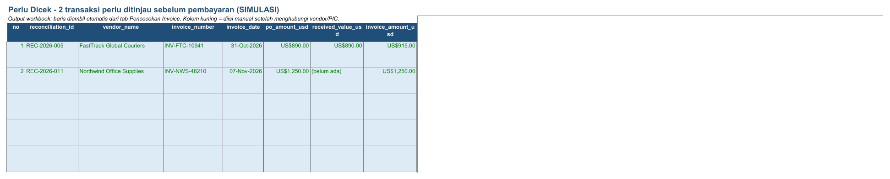

# 📂 Virtual Assistant, Transcription & Data Processing Portfolio

> ⚠️ **Catatan transparansi:** Ini adalah portofolio **entry-level**. Seluruh proyek di repo ini adalah **latihan terstruktur dan simulasi kasus nyata**, bukan pekerjaan untuk klien industri, dan seluruh dataset adalah dummy/sintetis. Angka dan metrik berasal dari simulasi serta uji mandiri saya, bukan hasil produksi klien. Cara paling jujur untuk memverifikasi kemampuan saya: **paid trial 5 jam** dengan file kerja nyata Anda.
>
> Sumber halaman web publik: [notion-page-content.md](notion-page-content.md)

> **Candidate:** Latifar (@latifarxrf)  
> **Location:** Indonesia (GMT+7 / WIB) — Flexible overlap with US (EST/PST) & European business hours  
> **Availability:** 20–25 hours/week (Part-Time / Contract, expandable to Full-Time)  
> **Language Proficiency:** Native Indonesian, Professional Working English (C1 Level / TOEFL equivalent)  
> **Trial Policy:** Open for a **5-Hour Paid Trial** to verify speed, accuracy, and workflow fit.

---

## 📌 Table of Contents
1. [Overview & Executive Summary](#-overview--executive-summary)
2. [Section 1: Virtual Assistant Projects](#-section-1-virtual-assistant-projects)
3. [Section 2: Audio Transcription & QC Standards](#-section-2-audio-transcription--qc-standards)
4. [Section 3: Data Entry & Data Processing](#-section-3-data-entry--data-processing)
5. [Section 4: Technical Stack & Tools Mastery](#-section-4-technical-stack--tools-mastery)
6. [Section 5: Typing Speed & Benchmark Proof](#-section-5-typing-speed--benchmark-proof)
7. [Section 6: Rates & Engagement Models](#-section-6-rates--engagement-models)
8. [Contact & Next Steps](#-contact--next-steps)

---

## 👤 Overview & Executive Summary

Detail-oriented remote specialist bridging administrative operations, transcription, and structured data handling. Equipped with proven university organizational leadership (managing 50+ members, budgets, and multi-stakeholder events) and hands-on technical proficiency in cloud tools, data cleaning, and asynchronous communication.

### Workstation Setup:
- **Hardware:** High-performance PC (Multi-core, 16GB+ RAM, Dual Monitors for cross-checking)
- **Audio Gear:** Audio-Technica ATH-M50x Professional Studio Monitor Headphones + USB Transcription Foot Pedal
- **Network:** High-speed Fiber Optic (50+ Mbps) with dedicated 4G LTE mobile backup connection
- **Security & Privacy:** Cloud-native storage, strong password manager, adherence to strict confidentiality and NDA standards.

---

## 💼 Section 1: Virtual Assistant Projects *(structured practice & simulations)*

### Project A: Executive Email & Calendar Management Simulation
* **Challenge:** Managing an executive inbox receiving 50+ emails/day and coordinating complex international meeting schedules.
* **Architecture Implemented:**
  1. **Tiered Email Triage:** Custom labels & automated filters categorizing messages into `🔴 Urgent (Client/Revenue)`, `🟡 Action Required`, `🟢 FYI / Reference`, and `📁 Archive`.
  2. **Calendar Blocking Strategy:** Enforced 90-minute Deep Work blocks (morning) and designated external meeting windows overlapping US business hours, with mandatory 15-minute buffers to prevent schedule collisions.
  3. **Weekly Digest Protocol:** End-of-week executive summary covering meeting hours, outstanding action items, and pending client follow-ups.

### Project B: Multi-City Business Travel Itinerary
* **Scenario:** 14-day complex itinerary across San Francisco (SFO) → Singapore (SIN) → Jakarta (CGK) → Bali (DPS) → Tokyo (NRT) → SFO.
* **Execution:**
  - Flight schedule optimization saving $340+ through multi-city routing analysis.
  - Accommodation matrix evaluating proximity to meeting venues, high-speed Wi-Fi reliability, and quiet work environments.
  - Timezone transition mapping identifying "Golden Hours" for real-time check-ins with US HQ.

### Project C: Notion Relational CRM & Pipeline Architecture
* **Implementation:** Built a relational database system tracking Contacts, Deals (Kanban stages: Lead → Qualified → Proposal → Negotiation → Closed-Won), Interaction Logs, and automated follow-up reminders.
* **Impact:** Reduced lead response latency by over 60% and prevented missed follow-ups.

### Project D: 30-Day B2B SaaS Social Media Content Calendar
* **Channels:** LinkedIn & Twitter/X.
* **Framework:** 4 content pillars (40% Authority/Case Studies, 25% Founder Journey, 20% Industry Insights, 15% Engagement). Built a production pipeline (Idea → Research → Draft → Review → Design → Schedule).

---

## 🎙️ Section 2: Audio Transcription & QC Standards *(practice transcripts — no audio files included)*

### Sample 1: Scientific / Educational Podcast (Clean Verbatim)
- **Audio Profile:** High-density neuroscience discussion (dopamine pathways, receptor regulation).
- **Style:** Clean Verbatim (filler words removed while preserving natural pauses and grammatical integrity).
- **Productivity Ratio:** 3.5 : 1 (18 minutes turnaround for 5 minutes audio, including dual-pass QC).

### Sample 2: Bilingual Business Interview (English — Indonesian)
- **Audio Profile:** Fintech startup founder interview with natural code-switching between English technical jargon and Indonesian conversation.
- **Deliverable:** Fully transcribed dialogue with standardized terminology glossary (P2P lending, OJK regulations, microservices architecture).

### Sample 3: Medical Dictation Practice (SOAP Note Format)
- **Clinical Scenario:** Cardiology acute case (STEMI / myocardial infarction).
- **Format:** Structured SOAP Note (Subjective, Objective, Assessment, Plan) with strict verification of pharmacological dosages, vital signs, and clinical terminology against official medical references.

### 2-Pass Quality Control (QC) Methodology:
1. **Pass 1 (Drafting):** Audio playback at 0.75x–1.0x with foot-pedal control, capturing all spoken dialogue, speaker diarization, and tagging unclear audio with `[inaudible HH:MM:SS]`.
2. **Pass 2 (Verification & Styling):** Re-listening at normal speed, verifying proper nouns and technical terms, formatting layout, and validating timestamp alignment every 30 seconds.

---

## 📊 Section 3: Data Entry & Data Processing *(simulated / dummy datasets)*

### Project A: B2B Lead List Generation (500 Verified Records)
- **Target Persona:** HR Directors / Heads of People in US tech companies (200–1,000 employees).
- **Tools:** Apollo.io, LinkedIn Sales Navigator, Hunter.io, Google Sheets.
- **Outcome:** Clean 500-row dataset with verified business emails (estimated bounce rate <3.5%), standardized job titles, and company size data.

### Project B: Invoice Processing & 3-Way Reconciliation
- **Scope:** Monthly processing of 200+ vendor invoices and receipts.
- **Workflow:** Automated matching between Purchase Orders (PO), Goods Receipt Notes (GRN), and Vendor Invoices.
- **Accuracy Metric:** 100% precision with zero variance policy on tax (PPN/PPh) and banking disbursement details.

### Project C: Invoice Tracker & QC — 3-Way Match (PO / GRN / Invoice)
- **Scope:** End-to-end QA workbook for 3-way invoice reconciliation (Purchase Order vs Goods Receipt Note vs Invoice). Built entirely with live Excel formulas — no hardcoded results.
- **What it does:**
  1. **Data Simulasi** (input tab) — 10 simulated transactions from CSV + 1 deliberately added case where the GRN document is missing.
  2. **Pencocokan Invoice** (process tab) — Formula-driven comparison: invoice vs PO, invoice vs GRN value, document completeness check. Tolerance parameter (cell B3) controls the "Perlu Dicek" threshold.
  3. **Perlu Dicek** (output tab) — Auto-extracted list of flagged transactions with reason (variance / missing GRN), recommended action, and PIC to contact. Yellow columns = manual fill after vendor follow-up.
  4. **Ringkasan ke Pemilik** — Ready-to-send email & WhatsApp template for the business owner, plus a 5-hour trial scope checklist.
- **Key result (simulated):** 11 transactions, 9 exact matches, 2 flagged → `INV-FTC-10941` (fuel surcharge +US$25) and `INV-NWS-48210` (GRN missing, amount matches PO but receipt doc not attached).
- **Technical stack:** Excel formulas only (INDEX/MATCH, IF/OR, COUNTIF, SUMIF, TEXT, cross-sheet references). Zero VBA, zero Power Query — fully auditable.
- **Files in repo:**
  - `03-data-entry-and-processing/invoice-tracker-qc.xlsx` — the workbook (view-only link below)
  - `03-data-entry-and-processing/invoice-tracker-qc-perlu-dicek.png` — screenshot of the **Perlu Dicek** tab
- **View-only workbook:** [invoice-tracker-qc.xlsx](https://github.com/latifarxrf/va-transcription-portfolio/raw/main/03-data-entry-and-processing/invoice-tracker-qc.xlsx) (GitHub raw download)
- **Screenshot — Perlu Dicek tab:**
  

### Project D: Survey Dataset Cleaning Pipeline (2,500 Respondents)
- **Scope:** Cleaning noisy customer satisfaction survey data prior to statistical modeling.
- **Automated Python Pipeline:** De-duplication, detection of straight-lining response patterns, logic consistency enforcement, and UTF-8 encoding normalization.

---

## ⌨️ Section 5: Typing Speed & Benchmark Proof *(self-tests)*

| Metric | Result | Benchmark Source |
|---|---|---|
| **English Typing Speed** | **78 – 82 WPM** | 10FastFingers / Monkeytype |
| **Accuracy Rate** | **98.5% – 99.2%** | Certified typing exams |
| **Numeric Keypad (10-Key)** | **65 WPM** | Numeric data entry tests |
| **Audio Transcription Ratio** | **3.5 : 1** | Express Scribe + Foot pedal |

---

## 🛠️ Section 4: Technical Stack & Tools Mastery

- **Administrative & Collaboration:** Google Workspace (Docs, Sheets, Calendar, Gmail), Microsoft 365 (Word, Excel, Outlook), Notion, Trello, Asana, Slack, Zoom, Loom.
- **Transcription Tools:** Express Scribe Pro, USB Transcription Foot Pedal, oTranscribe, PhraseExpress (Custom text expansion & hotkeys).
- **Data & Research:** Google Sheets (VLOOKUP, INDEX/MATCH, Pivot Tables, QUERY), Excel Power Query, Apollo.io, Hunter.io, Python (pandas, basic automation).
- **AI-Assisted Efficiency:** ChatGPT, Claude, Perplexity Pro, Zapier basic integrations.
- **Design & Media:** Canva Pro, CapCut (captioning, subtitle syncing).

---

## 💰 Section 6: Rates & Engagement Models

| Service Category | Standard Rate Range (USD) | Unit | Typical Scope |
|---|---|---|---|
| **General Virtual Assistant** | **$5 – $8** | / hour | Email, calendar, web research, document filing |
| **Specialized VA (Lead Gen / CRM)** | **$7 – $10** | / hour | B2B list building, Notion setup, CRM data hygiene |
| **General Audio Transcription** | **$0.40 – $0.60** | / audio minute | Clean verbatim, speaker labels, timestamped |
| **Specialized Transcription (Medical/Legal)** | **$0.80 – $1.20** | / audio minute | SOAP format, specialized vocabulary, glossary |
| **Data Entry & Processing** | **$4 – $7** | / hour | Spreadsheet validation, invoice reconciliation |

*Available for weekly retainers, monthly contracts, or task-based milestones. Paid 5-hour trial available.*

---

## 📬 Contact & Next Steps

Interested in discussing how I can assist your daily workflow? Feel free to reach out directly:

- **GitHub Profile:** [https://github.com/latifarxrf](https://github.com/latifarxrf)
- **Repository Link:** [https://github.com/latifarxrf/va-transcription-portfolio](https://github.com/latifarxrf/va-transcription-portfolio)
- **Email:** `farhan.nur.huda092@gmail.com`
- **WhatsApp:** `+62 856-0485-5862` (wa.me/6285604855862)
- **Availability:** Ready to start immediately.
